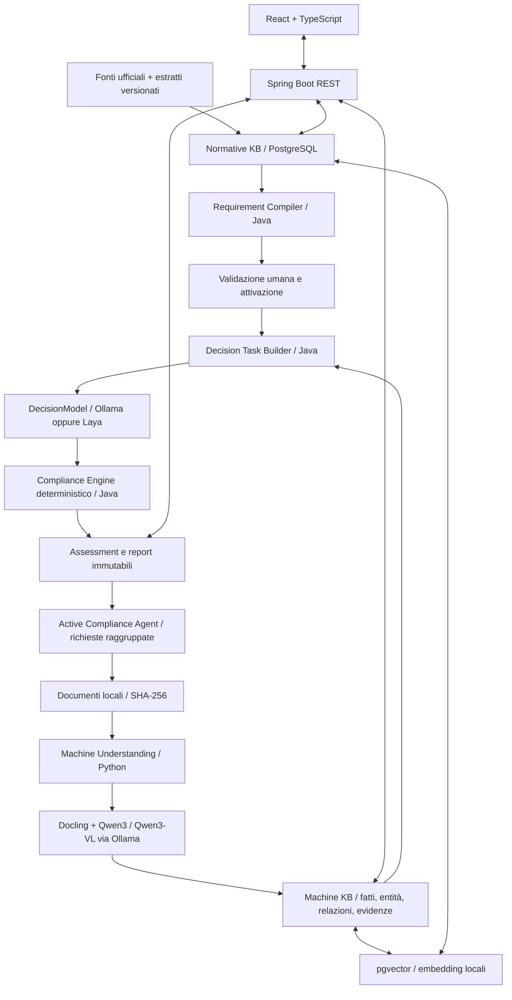

# RegMac — valutazione di conformità delle macchine

Applicazione locale per valutare una macchina rispetto al **Regolamento Macchine (UE) 2023/1230** e al **Cyber Resilience Act (UE) 2024/2847**: wiki dei requisiti con testi ufficiali e norme di riferimento, checklist per macchina con evidenze collegate, firma del valutatore e rapporto finale in PDF archiviato. Tutto gira sulla tua infrastruttura: nessun servizio cloud.

Guida per gli utenti: **[docs/GUIDA.md](docs/GUIDA.md)**.

## Installazione

Prerequisiti: Docker Desktop/Engine con Compose v2. Facoltativo: Ollama locale con i modelli indicati più sotto, per estrazione dei fatti e suggerimenti AI (senza modelli l'app funziona interamente; i documenti vengono comunque letti come testo).

```sh
cp .env.example .env          # impostare almeno DATABASE_PASSWORD
docker compose up -d --build
```

Aprire **http://localhost:5173**. Al primo accesso l'app chiede di creare l'**amministratore** (nome utente, nome e cognome, password di almeno 10 caratteri). Dalla sezione **Utenti** l'amministratore crea poi valutatori e lettori. Solo la porta web è pubblicata, e soltanto su `127.0.0.1`; database, backend e AI non sono esposti.

Ruoli:

| Ruolo | Può |
|---|---|
| Amministratore | tutto, inclusa la gestione utenti |
| Valutatore | creare macchine e checklist, valutare, caricare documenti, firmare i rapporti |
| Lettore | consultare wiki, checklist, rapporti e audit trail, senza modifiche |

`API_TOKEN` (in `.env`) è un accesso tecnico con ruolo amministratore per gli script (`scripts/demo.py`, `scripts/smoke.py`). È **vuoto e disattivato per impostazione predefinita**; non può firmare rapporti.

## Funzioni principali

- **Wiki normativa → Requisiti e valutazione**: 502 voci (articoli, allegati, punti), 351 valutabili. Ricerca, apertura del PDF ufficiale alla pagina, norme EN/ISO/IEC di riferimento per 256 requisiti (con stato di armonizzazione), valutazione direttamente dalla pagina. "Testo integrale" consente la lettura pagina per pagina.
- **Assessment → Checklist requisiti**: dati della macchina e profilo (macchina/quasi-macchina, capi dell'Allegato III, CRA). Per ogni requisito: esito, evidenze, **documenti collegati** (con nome, pagina e impronta SHA-256), norme applicate, rilievo, azione correttiva, responsabile, scadenza. **Suggerimento AI** facoltativo: propone un esito citando passaggi dei documenti, ma non lo applica mai da solo. Salvataggio automatico.
- **Firma**: la chiusura richiede esiti e motivazioni completi e la conferma della password dell'utente. Il rapporto PDF viene generato dal server, archiviato e registrato con la sua impronta SHA-256; la checklist diventa immutabile. Le modifiche successive passano da "Nuova revisione" (Rev. 2, 3…).
- **Rapporto finale**: PDF firmato (o bozza), CSV per Excel, JSON; anteprima a schermo.
- **Aggiornamento dei testi normativi**: quando il catalogo viene rigenerato, l'app segnala i requisiti il cui testo è cambiato rispetto a quando sono stati valutati e ne blocca la firma finché non vengono riconfermati.
- **Audit trail**: ogni operazione con data e autore.
- **Controlli automatici (sperimentale)**: il precedente motore di regole AI, mantenuto per sperimentazione.

## Operatività

```sh
scripts/backup.sh                    # database + documenti + rapporti → backups/regmac-AAAAMMGG-HHMMSS (con SHA256SUMS)
scripts/restore.sh backups/regmac-…  # verifica le impronte e ripristina (chiede conferma: sostituisce i dati attuali)
docker compose logs --tail 100 backend ai
docker compose stop / start          # i dati restano nei volumi
```

Pianificare il backup (es. ogni notte con `cron`) e conservarne una copia fuori dalla macchina. I rapporti firmati si trovano nel volume documenti (`/documents/reports`) e nel backup.

**Aggiornare i testi normativi** (es. testo consolidato o rettifica): sostituire i PDF in `data/normative/`, eseguire `python3 scripts/prepare_normative.py` e `python3 scripts/build_requirements.py`, poi `docker compose restart backend`. Il backend importa il nuovo catalogo solo se corrisponde ai PDF (SHA-256), conserva gli esiti per ID e segnala i testi cambiati.

**Dati dimostrativi** (facoltativo): impostare `API_TOKEN` in `.env`, riavviare il backend e lanciare `API_TOKEN=… python3 scripts/demo.py`: crea la macchina di prova «RM-01 · Linea dimostrativa». Svuotare poi `API_TOKEN`.

**Norme di riferimento**: in `data/normative/standards.json` (aggiornato al 11/11/2026 sull'elenco della Commissione per la dir. 2006/42/CE). Modificabile; dopo una modifica eseguire `build_requirements.py` e riavviare il backend.

## Architettura



Tre componenti applicativi: frontend statico, monolite modulare Java e un servizio AI Python. PostgreSQL con pgvector e Ollama sono infrastruttura locale. Non vengono usati servizi cloud durante il trattamento dei documenti. Installazione di pacchetti, immagini e pesi richiede una fase preliminare online; gli artifact possono essere trasferiti su una macchina isolata.

## Struttura

```text
backend/
  src/main/java/it/regmac/
    Domain.java                    # contratti tipizzati
    KnowledgeService.java          # le due KB, evidenze, revisione
    RequirementCompiler.java       # validazione/attivazione versioni
    DecisionTaskBuilder.java        # selezione pertinente, applicabilità
    ComplianceEngine.java          # regole deterministiche
    ActiveComplianceAgent.java     # richieste raggruppate
    AssessmentService.java         # orchestrazione e snapshot
    AiClient.java, Api.java, SearchApi.java
  src/main/resources/db/migration/  # Flyway
  src/test/                        # unità + integrazione Python reale
ai-service/
  app/contracts.py                 # Pydantic
  app/understanding.py              # parsing, estrazione, citazioni
  app/models.py                    # Ollama e Laya, CHOICE/NOUL/SCORE
  app/search.py                    # embedding e pgvector
  tests/
frontend/src/                      # UI React responsive
scripts/
  demo.py                          # macchina sintetica e grafo
  evaluate.py                      # metriche e temperature scaling offline
  fetch_normative.py                # acquisizione pubblica esplicita
  pgvector.sql                     # namespace/indice vettoriale
  smoke.py                         # smoke test su stack reale
  export_schemas.py                # JSON Schema dei contratti AI
contracts/                         # schemi esportati
data/
  normative/                       # controlli DRAFT e snapshot estratti
  demo/                            # manuale, questionario, risposta, conflitto
docs/                              # architettura, fonti, API, test e limiti
compose.yaml
.env.example
```

## Tecnologie

- Java **21**, Spring Boot **3.5.7**, JDBC, Flyway, Jackson; test JUnit 5.
- Python **3.12**, FastAPI **0.115.12**, Pydantic **2.11.4**, HTTPX, Psycopg.
- React **19.1**, TypeScript **5.8**, Vite **6.3**, Nginx; font di sistema, nessun CDN.
- PostgreSQL **17**, pgvector; file originali in volume locale, digest SHA-256.
- Ollama, `qwen3:8b`, `qwen3-vl:8b`; embedding `nomic-embed-text` (768 dimensioni).
- Docling e Laya opzionali. Dipendenze di base e lock npm presenti; gli extra AI hanno intervalli di versione e richiedono un lock dopo la qualificazione nell'ambiente target.

## Preparazione dei modelli

Su macOS è preferibile Ollama nativo per sfruttare Metal; un container Linux su Mac non usa automaticamente la GPU Apple.

```sh
ollama pull qwen3:8b
ollama pull qwen3-vl:8b
ollama pull nomic-embed-text
```

Qwen3-VL richiede almeno Ollama **0.12.7**, secondo il catalogo ufficiale. Configurare il listener nativo affinché il container AI possa raggiungerlo tramite `host.docker.internal`; limitarne l'accesso con le impostazioni di rete locali. Non usare tag `cloud`: gli adapter li rifiutano. Nessun pull automatico durante un assessment.

Alternativa con Ollama in Compose:

```sh
# In .env impostare OLLAMA_URL=http://ollama:11434
docker compose --profile ollama up -d ollama
docker compose exec ollama ollama pull qwen3:8b
docker compose exec ollama ollama pull qwen3-vl:8b
docker compose exec ollama ollama pull nomic-embed-text
docker compose up -d --build
```

La configurazione include CPU; per GPU NVIDIA aggiungere una configurazione Compose adeguata al runtime installato. I pesi 8B richiedono diversi GB ciascuno, oltre a runtime e cache di contesto; dimensionare sulla macchina target e caricare i modelli sequenzialmente se necessario.

### Docling

```sh
python3 -m venv .venv
.venv/bin/pip install -e './ai-service[documents,test]'
.venv/bin/docling-tools models download --output-dir runtime/models/docling
# .env: AI_EXTRAS=documents
docker compose build ai
docker compose up -d ai
```

Il parsing PDF/DOCX richiede l'extra e, per PDF, gli artifact locali. Il codice disabilita i servizi remoti di Docling. OCR e parsing grafico devono essere verificati con i documenti target; le citazioni di PDF sono riferite al Markdown estratto, non ancora a coordinate grafiche certificate. Le immagini usano Qwen3-VL e producono testo da revisionare.

### Laya

La documentazione pubblica del progetto supporta inferenza locale con `Agent(path).predict(state, questions)` e primitive `choice`, `noul`, `score`. L'adapter usa un checkpoint locale e imposta `HF_HUB_OFFLINE=1`; non scarica automaticamente pesi. Copiare checkpoint e dipendenze/tokenizer richiesti in `runtime/models/laya` dopo acquisizione e verifica separata.

```sh
# .env: AI_EXTRAS=documents,laya
# .env: DECISION_PROVIDER=laya
docker compose build ai
docker compose up -d ai
```

Laya è un modello decisionale distinto da Jev, non una sua riproduzione. L'adapter Ollama genera invece giudizi e probabilità dichiarate in JSON: **non equivale a una testa probabilistica non autoregressiva e non è calibrato sul dominio**. Entrambi sono conservativi (`abstain=true`) finché non è qualificata una calibrazione specifica. La verifica documentale dell'API Laya non equivale a un test d'inferenza dei pesi.

## Sviluppo e test

```sh
python3 -m venv .venv
.venv/bin/pip install -e './ai-service[test]'
.venv/bin/pytest ai-service/tests -q
mvn -f backend/pom.xml test
npm --prefix frontend ci
npm --prefix frontend run build
```

I test Java di integrazione avviano un vero FastAPI dal virtualenv `.venv`, su porta loopback temporanea, e usano H2 in modalità PostgreSQL. Richiedono quindi Python preparato come sopra e il permesso di aprire socket locali. Nessun modello è simulato come inferenza reale. Un test contrattuale Python usa un test double esplicitamente nominato.

```sh
# Dopo l'avvio Compose, verifica API, persistenza PostgreSQL e import reale.
python3 scripts/smoke.py
```

Per sviluppo senza container serve PostgreSQL locale con estensione pgvector e schema `scripts/pgvector.sql`; avviare FastAPI con `cd ai-service && ../.venv/bin/uvicorn app.main:app --host 127.0.0.1`, il backend con `mvn -f backend/pom.xml spring-boot:run` specificando i percorsi assoluti `NORMATIVE_SEED` e `DOCUMENT_STORAGE`, e la UI con `npm --prefix frontend run dev`.

## Valutazione sperimentale

`python3 scripts/evaluate.py heldout.jsonl --fit calibration.jsonl --output evaluation.json` calcola accuratezza, accuratezza selettiva, Brier score, NLL, ECE, falsi positivi e astensione; stima una temperatura su un insieme di calibrazione distinto. I JSONL devono contenere probabilità e label validate da esperti. Non sono inclusi risultati scientifici inventati né un dataset di esperti. Il risultato non viene attivato automaticamente nel serving: richiede binding al digest del modello e alle versioni delle domande, validazione e policy di rischio.

## Stato e limiti

Il percorso eseguibile iniziale comprende due requisiti parziali e quattro controlli. Regole, fatti e reviewer demo non costituiscono validazione giuridica. Le date valgono per i controlli selezionati, non per tutti gli obblighi dei regolamenti. Il CRA include obblighi con scadenze diverse, non implementati qui.

Sono ora importati anche i due PDF integrali italiani forniti dall'utente: Regolamento Macchine (102 pagine, pubblicazione originale del 29 giugno 2023) e CRA (81 pagine, pubblicazione originale del 20 novembre 2024). La Wiki consente consultazione per pagina, ricerca testuale locale e download degli originali verificati tramite SHA-256. `scripts/prepare_normative.py` prepara `data/normative/corpus.json` con Poppler; il backend importa il corpus in modo transazionale e idempotente all'avvio. Non sono testi consolidati: rettifiche e modifiche successive richiedono importazione e revisione separate. Il caricamento integrale non genera né approva automaticamente controlli aggiuntivi. Gli embedding del corpus restano da predisporre quando sarà disponibile un modello locale.

Il sistema conserva natura dichiarata/inferita/verificata/ritirata e uno snapshot per assessment. Il test verificato rappresenta l'attestazione umana del protocollo, non una prova tecnica eseguita dall'app. Non sono implementati scanner PLC, test di penetrazione o certificazione automatica.

Gli adapter Qwen3, Qwen3-VL, Docling, Laya ed embedding sono implementati ma l'inferenza con i relativi pesi non è stata eseguita nell'ambiente di sviluppo. Il dettaglio delle verifiche reali è in [docs/TESTING.md](docs/TESTING.md).

Implementati: utenti individuali con ruoli, firma con conferma della password, rapporto archiviato con impronta, audit con autore, backup verificati. Restano consigliati per installazioni multi-sede o esposte in rete: HTTPS con reverse proxy e autenticazione aziendale (SSO), cifratura dei volumi a riposo, registro di audit su supporto WORM, firma elettronica qualificata se richiesta contrattualmente, job asincroni per documenti molto grandi.

Passi successivi: corpus normativo completo revisionato, citazioni per pagina/bounding box, scope giuridico articolato, versioni/configurazioni macchina e scadenza evidenze, calibrazione su esperti, training Laya, workflow di approvazione e test tecnici integrati.
