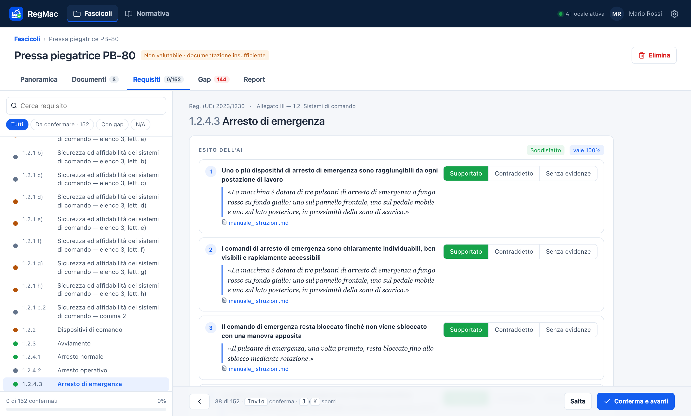
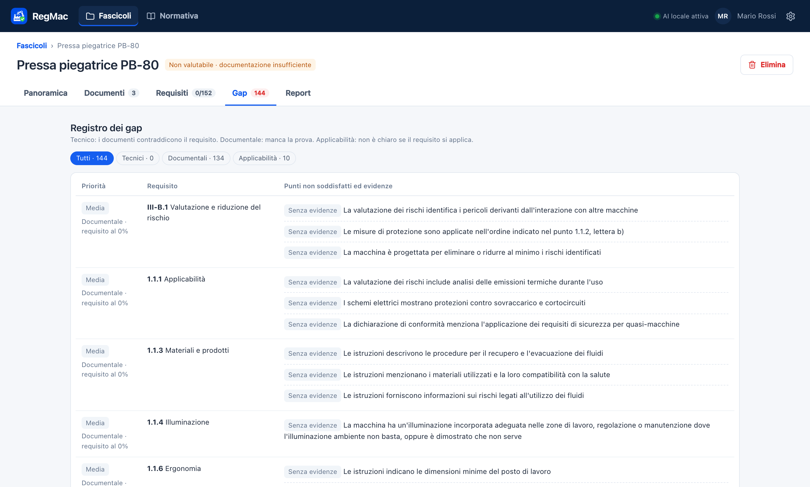
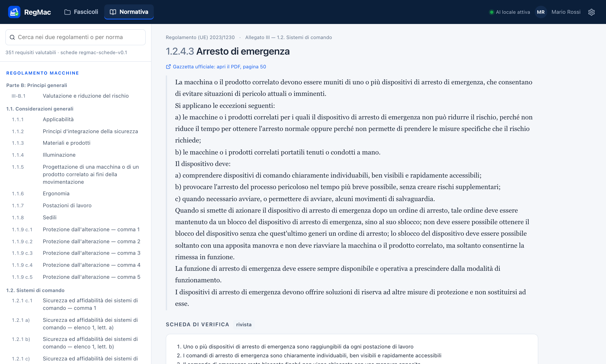

<p align="center">
  
</p>

<h1 align="center">RegMac</h1>

<h3 align="center">Pre-assessment di macchine con l'AI, sul tuo computer.</h3>

<p align="center">
  Carichi la documentazione tecnica di una macchina: l'AI locale controlla, requisito per requisito, il
  Regolamento Macchine (UE) 2023/1230 e il Cyber Resilience Act (UE) 2024/2847, e prepara un report con
  score di compliance, gap e documenti da richiedere. Ogni esito cita la frase del documento da cui deriva.
  I documenti non lasciano mai il computer.
</p>

<p align="center">
  <a href="https://github.com/nico9902/regmac/releases/latest"></a>
  <a href="https://github.com/nico9902/regmac/releases"></a>
  
  
  
  <br>
  
  
  
</p>

<p align="center">
  <a href="#installazione">Installazione</a> ·
  <a href="#cosa-fa">Cosa fa</a> ·
  <a href="#come-funziona">Come funziona</a> ·
  <a href="#lo-score">Lo score</a> ·
  <a href="#limiti">Limiti</a> ·
  <a href="#per-sviluppatori">Per sviluppatori</a>
</p>

<p align="center">
  <a href="https://github.com/nico9902/regmac/releases/latest/download/RegMac-Windows-x64-setup.exe"><picture>
    <source media="(prefers-color-scheme: dark)" srcset="assets/readme/download-windows-dark.svg">
    
  </picture></a>
  <a href="https://github.com/nico9902/regmac/releases/latest/download/RegMac-macOS-arm64.dmg"><picture>
    <source media="(prefers-color-scheme: dark)" srcset="assets/readme/download-macos-dark.svg">
    
  </picture></a>
  <a href="https://github.com/nico9902/regmac/releases/latest/download/RegMac-Linux-x64.AppImage"><picture>
    <source media="(prefers-color-scheme: dark)" srcset="assets/readme/download-linux-dark.svg">
    
  </picture></a>
  <br>
  <sub>Gratuito · richiede <a href="https://ollama.com/download">Ollama</a> · circa 5,5 GB di modelli scaricati al primo avvio · nulla esce dal computer</sub>
  <br>
  <sub>Altri formati: <a href="https://github.com/nico9902/regmac/releases/latest/download/RegMac-Windows-x64.msi">Windows .msi</a> · <a href="https://github.com/nico9902/regmac/releases/latest/download/RegMac-Linux-x64.deb">Linux .deb</a> · <a href="https://github.com/nico9902/regmac/releases">tutte le versioni</a></sub>
</p>

<p align="center">
  <picture>
    <source media="(prefers-color-scheme: dark)" srcset="assets/readme/requisiti-dark.png">
    
  </picture>
</p>

---

## Installazione

1. **Installa Ollama** da [ollama.com/download](https://ollama.com/download): è il motore che fa girare l'AI sul tuo computer.
2. **Scarica RegMac** per il tuo sistema con i pulsanti qui sopra e installalo.
3. **Primo avvio**: RegMac chiede nome e organizzazione per l'intestazione dei report. Poi controlla Ollama e scarica i modelli che mancano, mostrando l'avanzamento:
   - `qwen3:8b`, 5,2 GB;
   - `nomic-embed-text`, 274 MB.

Gli installatori non sono ancora firmati, quindi al primo avvio il sistema mostra un avviso:

| Sistema | Cosa fare |
|---|---|
| **macOS** | apri il `.dmg` e trascina RegMac in Applicazioni. Al primo avvio: clic destro su RegMac → **Apri** → **Apri** |
| **Windows** | se compare «Windows ha protetto il PC»: **Ulteriori informazioni** → **Esegui comunque** |
| **Linux** | AppImage: `chmod +x RegMac-Linux-x64.AppImage` e avvialo. Debian/Ubuntu: `sudo apt install ./RegMac-Linux-x64.deb` |

**Requisiti:** 16 GB di RAM consigliati, circa 7 GB liberi su disco. Con una scheda grafica o un Mac Apple Silicon l'analisi è molto più veloce.

## Cosa fa

- **Fascicolo per macchina**: dati della macchina, documenti (PDF con testo, DOCX, TXT, MD), esiti, gap e report.
- **Profilo proposto dall'AI**: dai documenti l'AI propone il profilo della macchina, con la frase che giustifica ogni risposta. Tu confermi. Le domande sono per esempio:
  - è una macchina completa o una quasi-macchina?
  - si sposta? solleva carichi o persone?
  - ha software o accesso remoto (quindi si applica il CRA)?
- **Pre-valutazione automatica** di tutti i requisiti applicabili, in sottofondo. Circa 5 minuti per 150 requisiti su un Mac M-series.
- **Revisione rapida**: per ogni punto di controllo vedi la risposta dell'AI e la citazione, e puoi correggerla. Invio conferma e passa al successivo.
- **Registro dei gap**, di tre tipi:
  - **tecnici**: i documenti contraddicono il requisito;
  - **documentali**: manca la prova;
  - **di applicabilità**: non è chiaro se il requisito si applica.
- **Report PDF** con score, massimo raggiungibile, score per area, gap, documenti da richiedere, dettaglio con citazioni e metodo.
- **Normativa consultabile**: testo ufficiale dei due regolamenti, schede di verifica e norme tecniche di riferimento.

<p align="center">
  
  
</p>

## Come funziona

```
Documenti ──► testo diviso in frasi ──► indice semantico (nomic-embed-text)
                                              │
Scheda di verifica del requisito ─────────────┤  per ogni punto di controllo: le 3 frasi più pertinenti
(condizione di applicabilità + punti)         ▼
                                   qwen3:8b giudica ogni coppia punto–frase:
                                   la frase lo DIMOSTRA, lo CONTRADDICE o NON C'ENTRA
                                              │  una conferma o una contraddizione vale solo se
                                              ▼  due domande formulate diversamente concordano
                                   esito del requisito ──► score, gap, report
```

- Ogni esito positivo o negativo **cita la frase** da cui deriva; senza una frase che lo dimostri il punto resta «senza evidenze».
- **Risultati ripetibili**: temperatura 0 e seme fisso. I giudizi sono salvati: rilanciando, si ricalcola solo ciò che è cambiato.
- **Tutto locale**: l'interfaccia comunica solo con il motore sul tuo computer (porta locale con token casuale).

## Lo score

- **Score** = media, sui requisiti applicabili, della quota di punti di controllo supportati. I punti contraddetti e quelli senza evidenze valgono 0.
- **Massimo raggiungibile** = lo stesso calcolo, come se le evidenze mancanti risultassero favorevoli. La differenza è quanto può recuperare il fabbricante portando la documentazione. Sotto il massimo restano solo i gap tecnici.
- **Copertura delle evidenze** = quota di punti su cui i documenti dicono qualcosa di netto. **Sotto il 30%** il fascicolo è dichiarato **«non valutabile: documentazione insufficiente»** invece di mostrare uno score fuorviante.

## Limiti

- RegMac fa un **pre-assessment documentale**. Non è la valutazione della conformità prevista dall'art. 25 del Reg. (UE) 2023/1230 o dall'art. 32 del Reg. (UE) 2024/2847. Non sostituisce la valutazione dei rischi del fabbricante né l'organismo notificato, quando richiesto.
- **Schede di verifica**: 16 sono riviste a mano; le altre 335 sono bozze generate con l'AI e vanno riviste da un esperto.
- **Modello piccolo**: un modello da 8 miliardi di parametri sbaglia. Per questo il sistema è prudente: nel dubbio un punto resta «senza evidenze», mai «conforme». Ogni esito resta comunque da rivedere.
- I **PDF scansionati** (immagini senza testo) non vengono ancora letti.
- I testi dei regolamenti sono le pubblicazioni originali in Gazzetta ufficiale, non consolidate.

## Per sviluppatori

| Cartella | Contenuto |
|---|---|
| [`desktop/tauri`](desktop/tauri) | finestra nativa (Tauri, Rust): avvia il motore Java incluso, schermata di caricamento, chiusura ordinata |
| [`desktop/app`](desktop/app) | motore (Java 21, Spring Boot): pre-valutazione, client di Ollama e download dei modelli, score e gap, report PDF |
| [`desktop/ui`](desktop/ui) | interfaccia (React + TypeScript) |
| [`data/normative`](data/normative) | testi ufficiali, catalogo dei requisiti, norme tecniche, schede di verifica |
| [`experiments/preassessment`](experiments/preassessment) | prove di accuratezza e velocità del motore AI |
| [`docs/prototipo`](docs/prototipo) | prototipo cliccabile dell'interfaccia |

**Compilare** sul sistema in uso (servono JDK 21, Node.js e Rust):

```bash
desktop/build.sh        # .dmg su macOS · .msi e .exe su Windows (Git Bash) · .deb e .AppImage su Linux
```

**Pubblicare una versione**: il workflow [`.github/workflows/desktop.yml`](.github/workflows/desktop.yml) costruisce i tre sistemi e pubblica la Release, a cui puntano i pulsanti di download.

```bash
git tag v1.0.1 && git push origin v1.0.1
```

La precedente versione server (Docker, PostgreSQL, utenti e ruoli) è descritta in [`docs/SERVER.md`](docs/SERVER.md).
